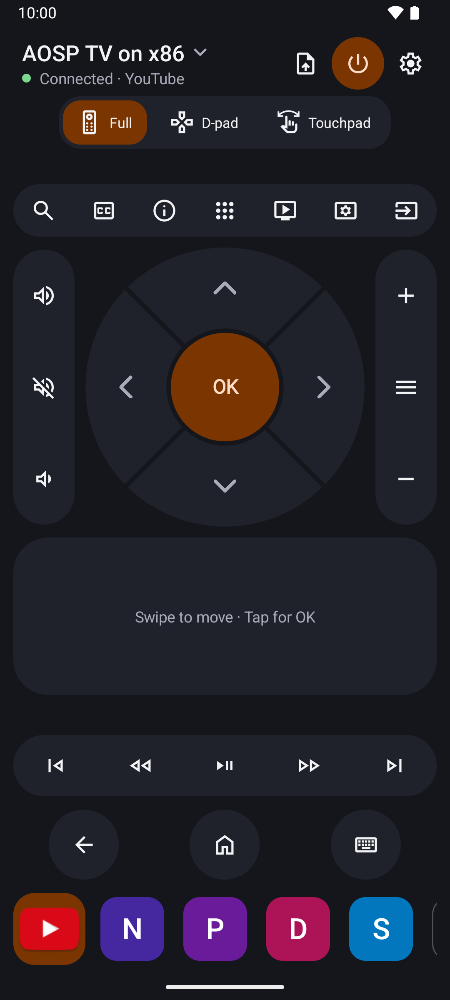

# Libremote for Android TV

A private phone remote for Android TV and Google TV. On the phone it is called Libremote.



Libremote pairs with your TV the way Google's own remote app does, with the code the TV shows, but it has no
account, no ads, no analytics and no crash reporting. It talks only to your TV, over your Wi-Fi.

- **Three ways to steer:** Full, D-pad or touchpad. Hold any button for the TV's long press, hold an arrow to scroll.
  Full adds keys for search, captions, info, apps, guide, TV settings and input, and a swipe strip.
- **Typing:** when a text field opens on the TV, the phone's keyboard opens and the text appears as you type.
- **Volume on the left**, or the phone's own volume buttons. **Channels or apps on the right**: Channel +, Menu and
  Channel − on a TV; Search, Menu and Apps on a streaming box such as a Shield or a Chromecast.
- **Playback, power, Back and Home**, and **Find my remote** on TVs whose remote can beep.
- **App shortcuts for each TV**, learned from the apps you open there, most used first. Pin, rename, hide or add
  apps; text, icons or tiles in three sizes and up to three rows.
- **Send files to the TV** from the remote or from any app's share menu, encrypted, with a progress notification.
- **Several TVs**, About this TV, a Remote guide that names every button, light and dark themes, a themed icon on
  Android 13 and later, TalkBack support.

Libremote needs Android 8.0 or later. It works with TVs that run Google's Android TV Remote Service, which Google
TV and certified Android TV devices include.

## Libremote Receiver, on the TV

A small companion app for the TV, needed only for some things:

- **Sending files.** Photos, videos, APKs or anything else go to Download/Libremote on the TV. Select an APK to
  install it.
- **Opening any app from a shortcut** on TVs without the Play Store. With the Play Store, shortcuts work without it.
- **Real names and icons** for the TV's apps in Libremote's shortcut settings.

It accepts only your phones: the first time Libremote opens it from a phone, the TV asks whether to allow that
phone, showing a code your phone shows too. A phone you remove in its Settings stays removed until you allow it
again. Everything between them is encrypted with both ends authenticated. It listens only while its screen is open,
or for a moment when Libremote opens an app or fetches the app list. It needs Android TV 8.0 or later.
[SENDFILES.md](SENDFILES.md) explains the pairing, the encryption, what they protect against, and
[what pairing covers](SENDFILES.md#in-short-what-pairing-with-the-receiver-covers) (opening apps goes through the TV's
own pairing instead).

## Install

Download from the [latest release](https://github.com/sonalder-darlene/libremote-android-tv/releases/latest):

- `libremote-<version>.apk` on the phone. Open it from the Files app; Android asks once to allow installs from it.
- `libremote-receiver-<version>.apk` on the TV, if you want it: copy it on a USB stick and open it with a file
  manager, or run `adb install libremote-receiver-<version>.apk`.

If Play Protect says "App blocked to protect your device", choose **More details → Install anyway**. It says this
about apps from developers it hasn't seen before.

Then open Libremote: your TV appears under Nearby. Tap it and type the code the TV shows.

## Updates

Libremote can check GitHub for new versions of itself and of Libremote Receiver, from Settings. Automatic checks
are off until you turn them on, and nothing installs without your confirmation: on the phone for Libremote, on
the TV for the receiver, which Libremote sends over the encrypted connection.

Copies installed by an app store never offer this; the store keeps them up to date.

## Privacy

- **Nothing of its own:** no accounts, analytics, ads, crash reports or servers. Libremote talks to your TVs on
  your local network, and to GitHub only when it checks for updates.
- **Nothing about your phone to the TV:** the TV includes what remote apps tell it in its usage reports to Google,
  so Libremote doesn't tell it the phone's model or Android version.
- **Your key stays on the phone,** encrypted with Android's keystore.
- **Permissions:** network access; notifications, asked on your first send, for the progress of files you send
  (sending works without them); and installing apps, for updates. No storage permission: files come from Android's
  file picker or share menu.
- **Libremote Receiver** learns your phone's name over the encrypted connection, to list it among paired phones.
  Its permissions are network access, installing the APKs you send, and on Android TV 8 and 9 only, storage.

The full policy is in [PRIVACY.md](PRIVACY.md).

## Not there yet

Voice search, the TV's text suggestions as you type, a Quick Settings tile, and translations.

## For developers

**Build**

```sh
nix develop -c ./gradlew assembleStandardRelease :tv:assembleRelease
nix develop -c ./gradlew :protocol:test lintStandardDebug :tv:lintDebug
```

APKs land in `app/build/outputs/apk/standard/release/` and `tv/build/outputs/apk/release/`. Without Nix, use JDK 21
and an Android SDK with platform 36. The apps use plain framework views and no libraries.

**Modules**

- `protocol/`: the TV protocols as plain Kotlin, with tests against a simulated TV. [PROTOCOL.md](PROTOCOL.md)
  documents Google's remote protocol and how it was worked out; [SENDFILES.md](SENDFILES.md) documents Libremote
  Receiver's channel. `-Plibremote.tv=<address>` runs `LiveTvTest` against a real TV or the emulator, and
  `-Plibremote.receiver=<address>[:port]` runs `LiveReceiverTest` against a receiver.
- `app/`: the phone app. `standard` is for GitHub releases, F-Droid and other stores, with the opt-in updater
  (`app/src/standard/`), hidden when a store installed Libremote or the APK isn't signed with the release key.
  `play` is for Google Play, which forbids apps that update themselves, and has no updater
  (`./gradlew assemblePlayRelease`). A fork can point the updater at its own releases with
  `-Plibremote.updateUrl=https://api.github.com/repos/<owner>/<repo>/releases/latest` and
  `-Plibremote.releaseCert=<sha-256>`; a test build can use a local server (`http://10.0.2.2:8000/latest.json` from
  the phone emulator) serving a release JSON and the APKs.
- `tv/`: Libremote Receiver. It has no updater of its own; Libremote keeps it up to date.

**Signing**

Official APKs of both apps are signed with this certificate (SHA-256):

```
37:D4:36:A2:01:C7:59:FD:35:F4:85:DA:AB:3B:BD:3F:8D:54:15:6F:EA:67:3A:23:BB:CF:72:A6:F3:8E:6E:E4
```

Check a download with `apksigner verify --print-certs`. To sign your own builds, put a `keystore.properties` with
`storeFile`, `storePassword`, `keyAlias` and `keyPassword` at the repository root (it is gitignored). Without it,
release builds use the debug key.

**Releasing**

1. Set `versionName` and `versionCode` (MAJOR × 10000 + MINOR × 100 + PATCH) in `app/build.gradle.kts` and
   `tv/build.gradle.kts`.
2. Add the changes to `CHANGELOG.md` and to `app/fastlane/metadata/android/en-US/changelogs/<versionCode>.txt`
   (and `tv/fastlane/…` when the receiver changed), 500 characters at most.
3. Commit, tag `v<version>`, and build from a clean checkout of the tag.
4. Attach `libremote-<version>.apk` (the `standard` build) and `libremote-receiver-<version>.apk` to the GitHub
   release. The updater looks for those names and shows the release notes. When the receiver didn't change, attach
   the previous receiver APK under its own version.

**Emulators**

`nix develop .#emulator` provides an Android TV emulator, which includes Google's remote service, and a phone
emulator; `nix develop .#emulator-old-tv` provides Android TV 8.0 and 9. A phone emulator reaches its host at
`10.0.2.2`, so forward the TV's ports from the TV emulator's console and add the TV in the app as `10.0.2.2`:

```sh
adb -s emulator-5554 emu redir add tcp:6466:6466
adb -s emulator-5554 emu redir add tcp:6467:6467
adb -s emulator-5554 emu redir add tcp:6469:6469     # Libremote Receiver
```

`adb forward` does not work: the TV ignores connections that come from itself.

## Licence

Libremote is free software under the [GNU General Public License v3.0 only](LICENSE) (`GPL-3.0-only`). The
Material Symbols icons are listed in [NOTICE.md](NOTICE.md).

Android TV and Google TV are trademarks of Google LLC. Libremote is not made, endorsed or sponsored by Google; it
implements the protocol of Google's Android TV Remote Service independently so that it works with TVs people own.
